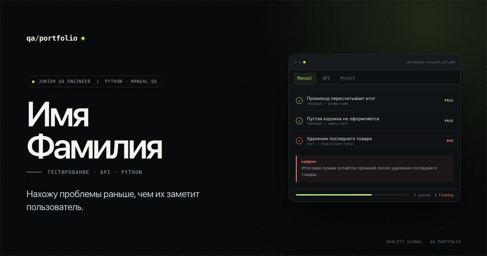

# QA Portfolio — Quality Signal

Персональный сайт-портфолио начинающего QA Engineer. Тёмный графитовый интерфейс, один акцентный цвет, интерактивный отчёт тестирования и честная подача навыков без выдуманных достижений.



## Стек

- React 19 + TypeScript
- Vite
- CSS Modules и дизайн-токены
- Oxlint
- Без UI-kit, animation- и icon-библиотек

## Локальный запуск

Требуется Node.js 22.12+ и npm.

```bash
npm install
npm run dev
```

Vite покажет адрес локального сервера, обычно `http://localhost:5173`.

### Скрипты

| Команда | Действие |
| --- | --- |
| `npm run dev` | Dev-сервер с hot reload |
| `npm run build` | Проверка типов и production-сборка в `dist/` |
| `npm run preview` | Локальный просмотр production-сборки |
| `npm run lint` | Oxlint |
| `npm run typecheck` | Только проверка TypeScript |
| `npm run check` | Линт + сборка |

## Где менять контент

Весь контент вынесен из компонентов:

| Файл | Что внутри |
| --- | --- |
| `src/content/profile.ts` | Имя, роль, интро, email, GitHub, Telegram, навигация |
| `src/content/skills.ts` | Категории навыков, статусы, текущий фокус |
| `src/content/projects.ts` | Демо-кейсы, стек, что тестировалось, найденные проблемы |
| `src/content/about.ts` | Текст «Обо мне», цель, принципы, факты |
| `src/types/content.ts` | Типы контента |

### Что заменить перед публикацией

1. **Профиль** — `profile.ts`: имя, email, GitHub, Telegram. Сейчас там заглушки `Имя Фамилия`, `hello@example.com`, `@username`.
2. **Обучение и опыт** — `about.ts`: два блока помечены как `добавить`. Замените их на реальные данные или удалите из массива `facts`.
3. **Проекты** — `projects.ts`: замените демо-кейсы. Если у проекта есть репозиторий, добавьте `repoUrl` — кнопка в модальном окне станет активной.
4. **SEO** — `index.html`: title, description, Open Graph, JSON-LD, canonical. После появления домена добавьте абсолютные URL для `og:image` и `og:url`.
5. **OG-изображение** — `public/og-image.png` (1200×630). Замените, если изменилось имя или позиционирование.
6. **Домен** — добавьте `sitemap.xml` и строку `Sitemap` в `public/robots.txt` после публикации.

Все демо-проекты явно помечены бейджем «Демо-кейс» и не выдаются за реальный опыт.

## Архитектура

```text
src/
├── components/
│   ├── layout/       Header, Footer
│   ├── sections/     Hero, Skills, Projects, About, Contacts
│   ├── projects/     ProjectCard, ProjectDialog
│   ├── ui/           Button, Badge, Icon, Reveal, Section…
│   └── visuals/      TestRunPanel
├── content/          Данные сайта
├── hooks/            Scrollspy, reveal, body lock
├── styles/           Токены и глобальные стили
└── types/            Типы контента
```

- Одностраничник с якорной навигацией, без роутера.
- Модальное окно проекта построено на нативном `<dialog>`: ESC, возврат фокуса, блокировка скролла.
- Тестовая панель — доступный tablist с управлением стрелками.
- Анимации отключаются при `prefers-reduced-motion`.
- Сборка использует `base: './'`, поэтому `dist/` можно разместить как в корне домена, так и в подпапке.

## Проверка

```bash
npm run check
npm run preview
```

Перед релизом проверено:

- production-сборка проходит без ошибок;
- консоль браузера чистая;
- нет горизонтального скролла на 390 / 834 / 1440 px;
- работают мобильное меню, якоря, табы тестовой панели, модальные окна и копирование email;
- у всех внутренних якорей есть цели;
- ссылки, модалки и меню доступны с клавиатуры.

## Деплой

### Vercel или Netlify

Подключите репозиторий, укажите:

- Build command: `npm run build`
- Output directory: `dist`
- Node version: 22+

### GitHub Pages

В проекте есть workflow `.github/workflows/deploy.yml`. После публикации репозитория:

1. Откройте **Settings → Pages**.
2. В разделе **Build and deployment** выберите **GitHub Actions**.
3. Сделайте push в `main` — сайт соберётся и опубликуется автоматически.

### Первый push в GitHub

Локальный репозиторий уже инициализирован (ветка `main`), файлы добавлены в индекс. Осталось указать автора коммита и закоммитить:

```bash
git config user.name "Ваше Имя"
git config user.email "you@example.com"
git commit -m "feat: initial QA portfolio"
```

Затем создайте пустой репозиторий `qa-portfolio` на github.com и свяжите его:

```bash
git remote add origin git@github.com:USERNAME/qa-portfolio.git
git push -u origin main
```

Либо одной командой через GitHub CLI, если он установлен:

```bash
gh repo create qa-portfolio --public --source=. --remote=origin --push
```

## Контакты в коде

Все реальные контакты пока заменены заглушками. Это сделано намеренно: сайт не приписывает владельцу несуществующие профили, проекты или достижения.
